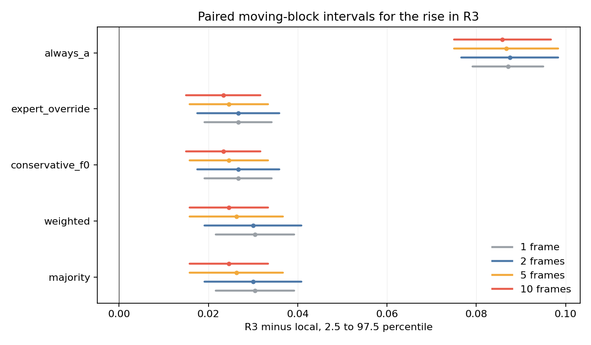
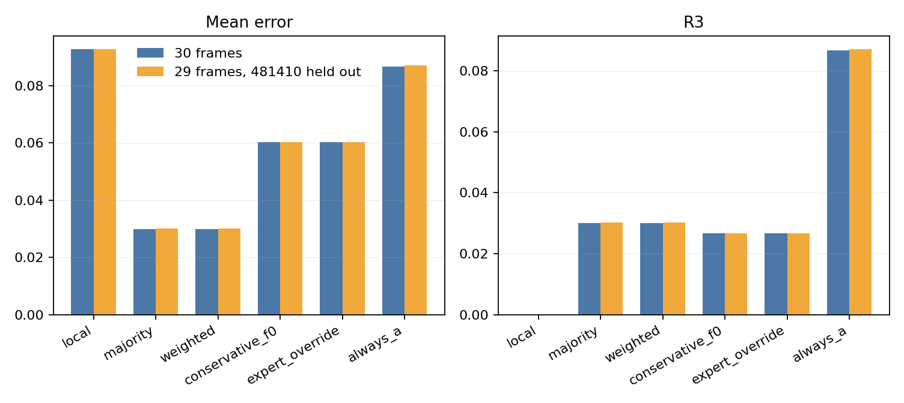

# CooperScene evaluation

Scores the frozen test export with the existing OCTOPUS code. `Octopus-main` is imported and not edited. The score, radius, and grid stay at the frozen validation values.

`run_evaluation.py` checks the manifest, calls `convert_to_trace`, then calls `perform_evaluation`. It also scores weighted broadcast, the P1 expert override, and always-A. The expert is the vehicle with the lowest validation region-error rate. Test performance is not used to choose that vehicle.

The seven export files are in `../test_inference`. The stock workflow was run on 25 November 2026: `prepare` wrote `prepared/` from `predictions.jsonl` and `manifest.json` (30 frames, 1,200 regions), then `evaluate` wrote `stock_study/comparison.csv`. `run_evaluation.py` repeats those two calls and adds weighted broadcast, expert override, always-A, the frame bootstrap, and the correlations.

```powershell
python "c:\Users\elyas\OneDrive\Desktop\Negin\Mobihoc_Extention\Mobihoc_Extention\Octopus-main\scripts\run_three_vehicle_real_study.py" prepare --source "c:\Users\elyas\OneDrive\Desktop\Negin\Mobihoc_Extention\Mobihoc_Extention\Negin_validation\P2\cooperscene\test_inference\predictions.jsonl" --manifest "c:\Users\elyas\OneDrive\Desktop\Negin\Mobihoc_Extention\Mobihoc_Extention\Negin_validation\P2\cooperscene\test_inference\manifest.json" --output "c:\Users\elyas\OneDrive\Desktop\Negin\Mobihoc_Extention\Mobihoc_Extention\Negin_validation\P2\cooperscene\evaluation\prepared"
python "c:\Users\elyas\OneDrive\Desktop\Negin\Mobihoc_Extention\Mobihoc_Extention\Octopus-main\scripts\run_three_vehicle_real_study.py" evaluate --scenario "c:\Users\elyas\OneDrive\Desktop\Negin\Mobihoc_Extention\Mobihoc_Extention\Negin_validation\P2\cooperscene\evaluation\prepared\scenario.json" --output "c:\Users\elyas\OneDrive\Desktop\Negin\Mobihoc_Extention\Mobihoc_Extention\Negin_validation\P2\cooperscene\evaluation\stock_study"
python "c:\Users\elyas\OneDrive\Desktop\Negin\Mobihoc_Extention\Mobihoc_Extention\Negin_validation\P2\cooperscene\evaluation\run_evaluation.py"
```

Tables below are also in `FINDINGS.md`, `metrics.json`, and `metrics.csv`. The stock script's rows are in `stock_study/comparison.csv`. Energy and latency there remain the hypothetical E1 profile.

## Result

The export passed the importer on 25 November 2026. `convert_to_trace` accepted 1,200 synchronized regions over 30 frames, one shared truth file, and three distinct run IDs (`bevfusion_single_lidar_test_vehicle1`, `vehicle2`, `vehicle3`). The same checkpoint SHA-256 is recorded for all three vehicles. Distinct run-ID strings were checked as different strings. That check does not establish statistically independent errors.

Validation region-error rates in the manifest, used as the reliability estimates:

| Vehicle | Validation region error | Regions |
|---|---:|---:|
| 1 | 0.1681 | 1,047 |
| 2 | 0.1366 | 1,047 |
| 3 | 0.1127 | 1,047 |

The predeclared expert is vehicle 3. Vehicle 2 has the lowest error on the test split (0.0642). That test rate was not used.

Majority and weighted broadcast cut the mean region error from 0.0928 to 0.0300. Conservative F0 cuts it to 0.0603, and that number matches the existing study script at confidence 0.90. The expert override matches F0 exactly. Always-A, which copies vehicle 3, reaches 0.0867.

Each policy is scored on 1,200 regions and 3,600 vehicle labels. Locally, 334 labels are wrong: 262 regions have exactly one wrong vehicle, and 36 regions have exactly two wrong. No region has all three wrong, which is why local R3 is 0. Those 36 regions are the whole of R2.

| Policy | Mean error | R2 | R3 | Joint false alarms | Joint misses | Corrections | Introduced errors |
|---|---:|---:|---:|---:|---:|---:|---:|
| Local | 0.0928 | 0.0300 | 0.0000 | 0 | 0 | 0 | 0 |
| Majority | 0.0300 | 0.0300 | 0.0300 | 1 | 35 | 262 | 36 |
| Weighted | 0.0300 | 0.0300 | 0.0300 | 1 | 35 | 262 | 36 |
| Conservative F0 | 0.0603 | 0.0300 | 0.0267 | 0 | 32 | 149 | 32 |
| Expert override | 0.0603 | 0.0300 | 0.0267 | 0 | 32 | 149 | 32 |
| Always-A | 0.0867 | 0.0867 | 0.0867 | 3 | 101 | 197 | 175 |

Majority fixes all 262 single-vehicle mistakes. On each of the 36 double errors it overwrites the one correct vehicle, which is the 36 introduced errors. Of those 36 regions, 35 are joint misses and 1 is a joint false alarm. Weighted broadcast makes the same decisions: the three validation rates are close, so a 2–1 split stays a 2–1 split.

There are 36 double-error regions, consisting of 35 double misses and one double false alarm. Conservative F0 accepts 90.25% of regions. It keeps R2 at 0.0300 and raises R3 to 0.0267 by accepting 32 of the 35 double misses. It rejects the one double false alarm. The stock script at confidence 0.75 accepts every region and reproduces majority. At 0.95 and 0.99 it changes no label, so the error stays at the local 0.0928.

| Stock method | Mean error | R2 | R3 |
|---|---:|---:|---:|
| local_only | 0.0928 | 0.0300 | 0.0000 |
| majority | 0.0300 | 0.0300 | 0.0300 |
| f0_0.750 | 0.0300 | 0.0300 | 0.0300 |
| f0_0.850 | 0.0489 | 0.0300 | 0.0275 |
| f0_0.900 | 0.0603 | 0.0300 | 0.0267 |
| f0_0.950 | 0.0928 | 0.0300 | 0.0000 |
| f0_0.990 | 0.0928 | 0.0300 | 0.0000 |

The override rule fires only when the declared expert error is at most 0.05 and F0's only objection is insufficient independent support. Vehicle 3's validation rate is 0.1127, so the rule stays idle and the override equals conservative F0. Always-A copies vehicle 3 on every region: 3 joint false alarms and 101 joint misses.

## Uncertainty and dependence

The frame bootstrap resamples the 30 frames, 2,000 times, seed 77232. Intervals are the 2.5 and 97.5 percentiles of the paired difference versus local.

| Policy minus local | Mean error | R2 | R3 |
|---|---|---|---|
| Majority | [−0.0675, −0.0578] | [0, 0] | [+0.0217, +0.0392] |
| Weighted | [−0.0675, −0.0578] | [0, 0] | [+0.0217, +0.0392] |
| Conservative F0 | [−0.0350, −0.0297] | [0, 0] | [+0.0192, +0.0342] |
| Expert override | [−0.0350, −0.0297] | [0, 0] | [+0.0192, +0.0342] |
| Always-A | [−0.0114, −0.0003] | [+0.0508, +0.0625] | [+0.0792, +0.0950] |

The mean-error improvement excludes zero for every broadcast and for F0. The R2 interval is [0, 0] because those policies never change which regions have two or more wrong vehicles. They only turn some two-wrong regions into three-wrong regions, which is why R3 rises. Always-A's mean-error gain is small, and its R2 and R3 intervals are both positive.

Local error indicators correlate at −0.070 for vehicles 1 and 2, −0.109 for vehicles 1 and 3, and +0.306 for vehicles 2 and 3. Putting all three vehicles in one dependence group makes conservative F0 accept nothing: the accepted fraction is 0 and the error returns to the local 0.0928. The same holds for the expert override. The gain above depends on counting the three run IDs as separate evidence. The shared checkpoint and the 0.31 correlation between vehicles 2 and 3 are why that count is an assumption.

## Against the P1 synthetic experiment

P1 Table 3 (shock 0.18, seed 77109, 4,000 synthetic queries):

| Policy | Mean error | R2 | R3 |
|---|---:|---:|---:|
| Local | 0.2003 | 0.1980 | 0.0020 |
| Majority | 0.1980 | 0.1980 | 0.1980 |
| Conservative F0 | 0.1366 | 0.1980 | 0.0040 |
| Expert override | 0.0138 | 0.0138 | 0.0138 |

The signs match for the two broadcast results. Majority lowered mean error, left R2 unchanged, and moved that R2 mass into R3. Conservative F0 lowered mean error and left R2 unchanged.

The sizes differ. P1's local error was 0.2003 under a designed shock. Here it is 0.0928, and 262 of the 298 imperfect regions are single-vehicle mistakes, so a vote removes most of them. P1's F0 moved R3 only from 0.0020 to 0.0040. There are 36 double-error regions, consisting of 35 double misses and one double false alarm. F0 accepts 32 of those 35 double misses and rejects the double false alarm, so R3 rises from 0 to 0.0267.

P1's expert override reached 0.0138 because the declared expert error on that draw was 1.5%, inside the 5% firing limit, and the override copied agent A on every query. The lowest validation rate here is 11.3%, outside that limit, so the override contributes nothing beyond F0. Copying vehicle 3 on every region still only reaches 0.0867, and it makes all three vehicles wrong together.

## Final audit

`../audit/audit_final.py` recomputed all 3,600 labels from the frozen export. The totals match `metrics.json` and the stock correction counts. A one-frame block bootstrap with seed 77232 reproduced the intervals above. The full write-up is `../P2_REPORT.md`.

Every test frame contains the same 40 circles on the frozen 7.5 m lattice. The validation gate had no failure: vehicle 1's ego drop was 30/437 annotated boxes, and 291/1,047 validation regions disagreed with the shared union. The exported test truth matches `ground_truth.jsonl` on all 1,200 rows. 327 regions are positive.

Conservative F0 accepts a 2–1 split only when vehicles 2 and 3 already agree. It corrects vehicle 1 on 149 regions and erases vehicle 1's correct detection on 32. Vehicles 2 and 3 do not change a label. Majority erases 35 correct detections and introduces 1 false alarm. Weighted broadcast matches majority on every label. The expert override matches F0 on every label.

The 35 lost detections sit on five cells. Twenty-one are (−45 m, 0 m). Frame `481410`, region `grid_031`, is the case both policies erase. Frame `481411`, region `grid_091` at (30 m, 0 m), is the case majority erases and F0 keeps. The drawings are in `../audit/figures/`.

Neighboring circles have error correlation +0.258 for vehicle 1 and +0.294 for vehicle 3. Lag-1 correlation on the same circle is 0.85 to 0.98. A moving-block bootstrap leaves the majority and F0 mean-error intervals below zero through 10-frame blocks. Always-A's mean-error interval includes zero from a block of two frames onward.

| Block | Majority mean error | F0 mean error | Always-A mean error |
|---|---|---|---|
| 1 frame | [−0.0675, −0.0578] | [−0.0350, −0.0297] | [−0.0114, −0.0003] |
| 2 frames | [−0.0689, −0.0567] | [−0.0356, −0.0294] | [−0.0133, +0.0019] |
| 5 frames | [−0.0711, −0.0586] | [−0.0364, −0.0311] | [−0.0150, +0.0039] |
| 10 frames | [−0.0711, −0.0606] | [−0.0364, −0.0322] | [−0.0150, +0.0028] |

## Final sensitivity

These three checks do not replace the 30-frame table above. Nothing here changes the score, the radius, the grid, or the reliability rates. Detector inference was not rerun. The script is `../final_sensitivity/run_sensitivity.py`. The same write-up is in `../final_sensitivity/FINDINGS.md` and `../P2_REPORT.md`.

### Annotation disagreement

The validation box files were replayed with the official rotation, the 3 m ego drop, the ±72 m window, and the 144 stored centers. The replay returned 291 disagreements on 1,047 common regions. Vehicle 1 misses 168 of those union hits, vehicle 2 misses 143, and vehicle 3 misses 113. All 291 are annotation coverage. Restoring vehicle 1's 30 ego-dropped boxes removes 0 of them. Across all 1,274 ego boxes on all 30 validation frames, the largest world-from-ego residual is 2.132e-14 m, and no box exceeds 1e-6 m.

The 291 region-frames occupy 15 repeated centers. The map and a frame drawing are in `../final_sensitivity/figures/gt_disagreement_map.png` and `../final_sensitivity/figures/gt_annotation_coverage_example.png`. The full per-vehicle table is in `../P2_REPORT.md` and `../final_sensitivity/FINDINGS.md`.

A secondary rescore keeps only test regions where every vehicle's kept annotations agree with the union. That subset retains 903 of 1,200 regions (2,709 labels) and drops 297, all of them positive. On those 903 regions the local error is 6/2,709, majority is 3/2,709 with the one double false alarm still present, and every policy has 0 joint misses. The 35 double misses stay in the primary union table. This subset does not replace it.

### R3 under temporal blocks

The moving-block bootstrap was run again for the change in R3. Lengths are 1, 2, 5, and 10 frames, with 2,000 draws and seed 77232. Blocks do not wrap from frame 481439 back to 481410. The interval is the 2.5 and 97.5 percentiles of policy R3 minus local R3. Length 1 matches the published frame bootstrap. Local R3 is 0 on every resample, because the export has no region where all three local labels are wrong. The plotted difference is the policy's own R3 on each draw.

| Policy minus local | 1 frame | 2 frames | 5 frames | 10 frames |
|---|---|---|---|---|
| Majority | [+0.0217, +0.0392] | [+0.0192, +0.0408] | [+0.0158, +0.0367] | [+0.0158, +0.0333] |
| Weighted | [+0.0217, +0.0392] | [+0.0192, +0.0408] | [+0.0158, +0.0367] | [+0.0158, +0.0333] |
| Conservative F0 | [+0.0192, +0.0342] | [+0.0175, +0.0358] | [+0.0158, +0.0333] | [+0.0150, +0.0317] |
| Expert override | [+0.0192, +0.0342] | [+0.0175, +0.0358] | [+0.0158, +0.0333] | [+0.0150, +0.0317] |
| Always-A | [+0.0792, +0.0950] | [+0.0767, +0.0983] | [+0.0750, +0.0983] | [+0.0750, +0.0967] |

Every lower endpoint stays above zero. Longer blocks make the interval a little wider and move the lower end down, so the repeated frames make the rise less precise. They do not remove it. The rise is unfavorable for every fusion rule in the table: after the temporal dependence is kept inside the resample, R3 is still higher than local.



### Frame 481410 held out

Frame 481410 is the smoke-test frame, and it is inside the primary 30-frame result. Holding it out leaves 29 frames, 1,160 regions, and 3,480 labels. The same frozen labels are rescored. One of the 36 double-error regions was on that frame, and it was the illustrated loss at `grid_031`. None of the joint false alarms were on it. The frame itself had 11 wrong local labels out of 120, close to the take average.

| Policy | 30-frame mean error | 29-frame mean error | 30-frame R2 | 29-frame R2 | 30-frame R3 | 29-frame R3 | 30-frame joint alarms | 29-frame joint alarms | 30-frame joint misses | 29-frame joint misses | 30-frame corrections | 29-frame corrections | 30-frame introduced | 29-frame introduced |
|---|---:|---:|---:|---:|---:|---:|---:|---:|---:|---:|---:|---:|---:|---:|
| Local | 334/3,600 = 9.278% | 323/3,480 = 9.282% | 36/1,200 | 35/1,160 | 0/1,200 | 0/1,160 | 0 | 0 | 0 | 0 | 0 | 0 | 0 | 0 |
| Majority | 108/3,600 = 3.000% | 105/3,480 = 3.017% | 36/1,200 | 35/1,160 | 36/1,200 | 35/1,160 | 1 | 1 | 35 | 34 | 262 | 253 | 36 | 35 |
| Weighted | 108/3,600 = 3.000% | 105/3,480 = 3.017% | 36/1,200 | 35/1,160 | 36/1,200 | 35/1,160 | 1 | 1 | 35 | 34 | 262 | 253 | 36 | 35 |
| Conservative F0 | 217/3,600 = 6.028% | 210/3,480 = 6.034% | 36/1,200 | 35/1,160 | 32/1,200 | 31/1,160 | 0 | 0 | 32 | 31 | 149 | 144 | 32 | 31 |
| Expert override | 217/3,600 = 6.028% | 210/3,480 = 6.034% | 36/1,200 | 35/1,160 | 32/1,200 | 31/1,160 | 0 | 0 | 32 | 31 | 149 | 144 | 32 | 31 |
| Always-A | 312/3,600 = 8.667% | 303/3,480 = 8.707% | 104/1,200 | 101/1,160 | 104/1,200 | 101/1,160 | 3 | 3 | 101 | 98 | 197 | 190 | 175 | 170 |

Dropping the smoke frame does not improve the policies. The ordering is the same, and the R3 gap remains. This hold-out is the sensitivity result. The primary claims stay on all 30 frames.


